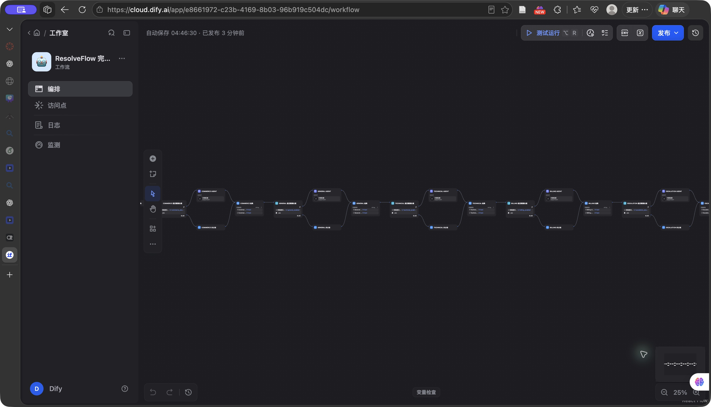
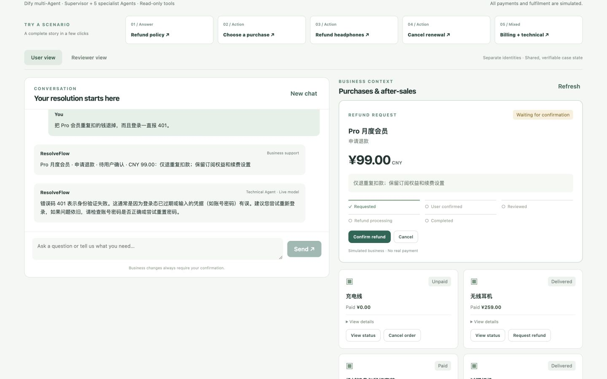
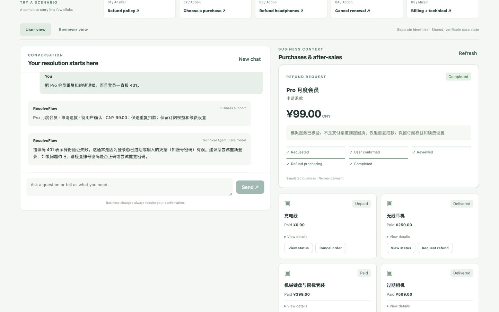

# ResolveFlow 多 Agent 工作流

Dify 负责理解请求和只读咨询，ResolveFlow 负责订单、报价、确认、审核与模拟退款。Vue 界面调用本机后端，本机后端再调用 Dify Cloud，因此不用暴露 localhost，也不用把 User / Reviewer JWT 传给 Dify。

当前应用：[ResolveFlow 完整售后编排](https://cloud.dify.ai/app/e8661972-c23b-4169-8b03-96b919c504dc/workflow)。已经发布，复用原来的本机应用凭据。

## 各 Agent 做什么

Supervisor 用 Qwen Plus 拆分业务意图和咨询任务。Code 节点校验角色和操作，再按需执行五个**原生 Dify Agent v2**，各自使用 Qwen3.6 Plus、独立提示词和工具调用。当前按需串行执行，不是并行，也不是五个 LLM 节点改了名字。

| Agent | 任务 | 只读工具 |
|---|---|---|
| Commerce | 检查用户明确的业务对象线索 | inspect_request_context、knowledge_search |
| General | 政策和一般咨询 | knowledge_search、inspect_request_context、create_handoff_summary |
| Technical | 错误码与技术排障 | lookup_error_code、knowledge_search、inspect_request_context |
| Billing | 账单证据、应扣与实扣比对 | check_billing_fields、compare_amounts、knowledge_search |
| Escalation | 人工交接摘要 | create_handoff_summary、inspect_request_context |

工具通过独立 Workflow `ResolveFlow Scoped Readonly Tools` 调用。角色字段只是工具路由信息，不是可信身份；真正的身份与权限检查留在 Python。工具集中没有确认、审核、退款执行或修改凭据的接口。金额比对只计算用户提供的数据，不能决定应退金额。交接摘要没有连接真人或提交工单。

汇总节点保留每个 Agent 的回答、状态、来源和工具返回记录。前端分别显示 Technical / Billing / Escalation 的回答；业务卡片金额仍来自 CommerceStore。工具记录是 Agent 回传的证据，不是独立签名的审计凭据；不得据此授予业务权限。

## 导入与启动

1. 导入 [readonly-tools.yml](readonly-tools.yml)，选择自己的知识库和模型，发布为工具，调用名设为 `resolveflow_readonly`。工具参数为 role、operation、query、arguments_json、context，返回 result。
2. 导入 [resolveflow-workflow.yml](resolveflow-workflow.yml)。它含 25 个节点、五个内联 Agent。换工作空间时，替换知识库引用及 Agent 工具 provider_id，并重新选择模型凭据。
3. 发布主工作流，创建应用 API Key。该 Key 与模型供应商 Key 不同。
4. 把凭据保存到工作树根目录的 `.env.dify`（Git 已忽略，权限应为 600）：

```dotenv
RESOLVEFLOW_USE_DIFY=1
DIFY_API_BASE=https://api.dify.ai/v1
DIFY_API_KEY=<Dify 应用 API Key>
AGENT_USE_LLM=0
```

本机后端启动：

```bash
RESOLVEFLOW_PYTHON=/Users/zhenxiangzhu/miniforge3/envs/resolveflow-demo/bin/python ./dify/start-backend.sh
```

前端在 `ResolveFlowFrontend` 运行 `VITE_DEMO_MODE=true npm run dev`。已有服务时不要重复启动。当前运行代码在 `codex/dify-agent` 工作树；原仓库未提交文件未改动。

Dify 接收本人模拟购买记录与最近六条对话。生产接入需要另行确定发送的数据范围。主工作流 DSL 不含 Key 或 JWT。[resolveflow-single-workflow.yml](resolveflow-single-workflow.yml) 仅保留此前两次 LLM 调用的旧流程供回退，它不属于多 Agent 方案。

## 本机验证（2026-10-11）

- 后端 351 项：342 通过，9 跳过。跳过项为 Postgres POC 5 项、可选 Redis / Chroma 依赖 4 项。
- 前端生产构建与 `git diff --check` 通过。
- 真实 Dify API 的五个招聘场景通过，另外通过 Billing + Escalation 复合请求。退款、确认、审核、退货验收、模拟到账、重复点击幂等和会话隔离由实际业务数据库验证。
- 场景一只运行 General；场景二至四运行 Commerce；场景五运行 Commerce + Technical。金额比对与人工请求运行 Billing + Escalation，返回 99 元差额以及“未接通真人”的摘要。
- 测试曾发现登录误入物流、额外角色分派和合法 Commerce 角色校验失败，已经修复并保留回归用例。失败请求未创建业务申请。

原生 Agent 单次运行开销较大，本次观测约 20–51 秒；早期过度分派曾达到约 100 秒。这是少量演示请求的耗时，不是性能基准。知识工具引用 Dify 知识库与 Qwen3 Rerank，未进行混合检索效果评测。支付仍为 simulated；技术回答是一般建议，没有检查真实账号。




浏览器验收：实际点击复合场景后显示 ¥99 卡片与独立 Technical 回答；用户确认 → Reviewer Approve → Simulate payment receipt → User Completed，刷新后 Case 恢复。Chat 本身不恢复。1440×900、1024×900、390×900 的 document scrollWidth 分别等于视口宽度，无横向溢出；金额、角色与确认按钮清楚。最新会话 console error / warning 均为 0。等待时场景、角色和发送控件禁用；业务失败会显示错误提示，不伪造成功。


[1024px 截图](screenshots/multiagent-1024.jpg) · [移动端截图](screenshots/multiagent-mobile.jpg)

另已在浏览器验证 General 普通咨询：独立显示 General Agent，来源可展开，没有空业务气泡，也不把一般咨询标为政策说明。
