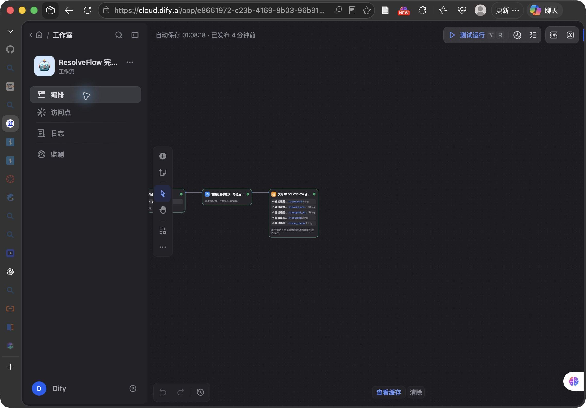
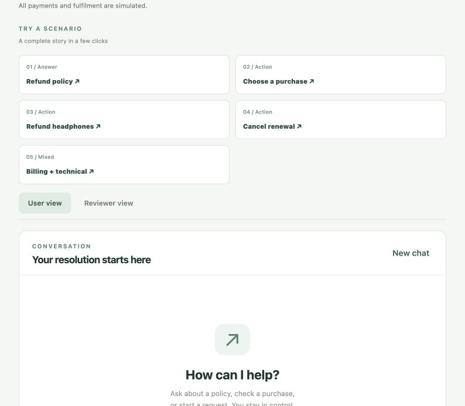

# ResolveFlow Dify 工作流

此目录包含可导入 Dify Cloud 的 Workflow DSL。业务界面保留 Vue，身份、订单、报价、用户确认、独立审核和模拟支付由 Python 后端负责。

流程：输入用户原话与本人订单 → Qwen 多意图解析 → 参数校验与只读错误码工具 → 政策检索 → 政策/技术回答 → 证据整理 → 返回后端。

## 本机连接

发布 Workflow 后，在访问点创建该应用的 API Key。在本机凭据文件设置：

```dotenv
RESOLVEFLOW_USE_DIFY=1
DIFY_API_BASE=https://api.dify.ai/v1
DIFY_API_KEY=<Dify 应用 API Key，非百炼 Key>
AGENT_USE_LLM=0
```

再用 Python 3.11 启动 `api.portfolio_demo:create_app`。由本机向 Dify 发起出站请求，无需公网暴露 localhost。保留现有 User/Reviewer JWT；这些 Token 不传给 Dify。

Dify 收到本人模拟购买记录和最近六条对话；生产接入需要另外评估数据范围与保留策略。Dify 的输出只作为操作建议，不能替代资格、金额、授权或用户确认。技术分支使用确定性错误码表，支持模型基于工具结果提出建议，不代表已经检查实际账号。

## 验证

新增六项 API 集成测试用 MockTransport 模拟 Dify 服务边界，验证真实业务数据库、身份隔离、确认审核及幂等性；不能把这些测试称为真实模型测试。

Dify Cloud 的真实预览已验证 Pro 重复扣款 + 401 复合请求，输出一个退款意图和独立咨询结果、只读工具证据。

当前 DSL 引用本工作空间知识库，换工作空间时需重新选择知识库和模型凭据。没有在文件中保存任何 Key。

## 此次本机状态

Dify 应用：https://cloud.dify.ai/app/e8661972-c23b-4169-8b03-96b919c504dc/workflow

调用凭据位于仓库工作树根目录 `.env.dify`，权限 600，已加入 `.gitignore`。启动时先 `set -a; source .env.dify; set +a`，再运行 Demo。不要提交或分享该文件。

后端全量回归：340 项，331 通过，9 跳过（Postgres POC 5 项，Redis/Chroma 依赖 4 项）。前端构建通过。

真实端到端 API：五个场景全部通过，另通过隔离检查。商品退款验证 ¥259、确认→审核→退货验收→模拟到账；重复 settle 只有一笔退款。Basic 关闭续费保留权益且无退款；Pro 重复扣款 ¥99 与 401 工具咨询同时返回。

浏览器已实际完成 Pro 退款确认→Reviewer 审核→模拟到账→刷新恢复 Completed。支付均为模拟。开发服务器控制台出现一条 Vite HMR WebSocket 连接错误，业务请求和页面操作正常；此为开发热更新连接，未声称控制台完全无错误。




本机启动命令：`RESOLVEFLOW_PYTHON=/Users/zhenxiangzhu/miniforge3/envs/resolveflow-demo/bin/python ./dify/start-backend.sh`；前端仍在 `ResolveFlowFrontend` 使用 `VITE_DEMO_MODE=true npm run dev`。已有服务运行时不要重复启动。
